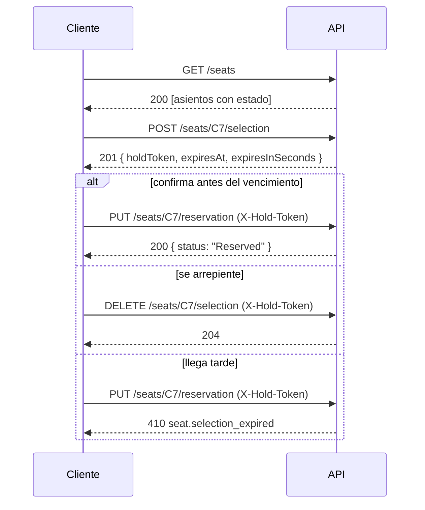

# Referencia de la API

La documentación interactiva está en **`/scalar`** y el documento OpenAPI en **`/openapi/v1.json`**, ambos generados a partir del código. Esta página resume el contrato para leerlo sin levantar la API.

- Base URL local: `http://localhost:5054`
- Formato: JSON. Las fechas van en UTC, en formato ISO 8601. El estado del asiento viaja como texto: `Free`, `Selected` o `Reserved`.
- Errores: [ProblemDetails (RFC 9457)](https://www.rfc-editor.org/rfc/rfc9457), con `Content-Type: application/problem+json` y un campo `code` estable.

## Flujo



## Asientos

La sala tiene 80 asientos: filas `A` a `H`, números `1` a `10`. El id es fila + número (`C7`) y **distingue mayúsculas**: `c7` responde 404.

## Endpoints

### `GET /seats`

Lista todos los asientos, ordenados por fila y número, con su **estado efectivo**: una selección vencida se informa como `Free`. Nunca incluye hold tokens.

```http
HTTP/1.1 200 OK

[
  { "id": "A1", "row": "A", "number": 1, "status": "Free",     "expiresAt": null },
  { "id": "A2", "row": "A", "number": 2, "status": "Selected", "expiresAt": "2026-10-17T00:42:48.341077+00:00" },
  { "id": "A3", "row": "A", "number": 3, "status": "Reserved", "expiresAt": null }
]
```

`expiresAt` solo tiene valor si el asiento está seleccionado y la selección sigue vigente.

### `POST /seats/{id}/selection`

Selecciona un asiento libre, o uno cuya selección anterior venció.

```http
HTTP/1.1 201 Created
Location: /seats/C7/selection

{
  "seatId": "C7",
  "holdToken": "d203d45e-3416-45b2-93a8-bec78494dc16",
  "expiresAt": "2026-10-17T00:42:48.3410771+00:00",
  "expiresInSeconds": 300
}
```

- `holdToken` es la única prueba de que esta selección es tuya. Se necesita para confirmar o liberar, y **no se vuelve a mostrar**.
- `expiresInSeconds` sirve para mostrar una cuenta regresiva sin depender del reloj del cliente. La autoridad sobre el vencimiento es siempre el servidor.

| Status | `code` | Cuándo |
|---|---|---|
| 404 | `seat.not_found` | El asiento no existe. |
| 409 | `seat.already_selected` | Otro cliente tiene una selección vigente. |
| 409 | `seat.already_reserved` | El asiento ya está reservado. |
| 409 | `seat.concurrent_modification` | Otro request modificó el asiento al mismo tiempo y ganó. |

### `PUT /seats/{id}/reservation`

Confirma la reserva de un asiento seleccionado. Requiere el header `X-Hold-Token`.

```http
PUT /seats/C7/reservation
X-Hold-Token: d203d45e-3416-45b2-93a8-bec78494dc16
```
```http
HTTP/1.1 200 OK

{ "id": "C7", "row": "C", "number": 7, "status": "Reserved", "expiresAt": null }
```

| Status | `code` | Cuándo |
|---|---|---|
| 400 | — | Falta `X-Hold-Token` o no es un GUID válido. |
| 403 | `seat.invalid_hold_token` | El token no corresponde a la selección vigente. |
| 404 | `seat.not_found` | El asiento no existe. |
| 409 | `seat.not_selected` | El asiento no tiene una selección vigente. |
| 409 | `seat.already_reserved` | El asiento ya está reservado. |
| 409 | `seat.concurrent_modification` | Otro request modificó el asiento al mismo tiempo y ganó. |
| 410 | `seat.selection_expired` | La selección venció. |

### `DELETE /seats/{id}/selection`

Libera un asiento seleccionado. Requiere el header `X-Hold-Token`.

```http
HTTP/1.1 204 No Content
```

Responde los mismos errores que `PUT /seats/{id}/reservation`.

## Precedencia de errores

Si aplica más de un error, se informa el primero de esta lista:

1. **410**: la selección venció. Se informa sin validar el token, porque que venció ya es visible en `GET /seats`.
2. **409**: el estado del asiento no permite la operación.
3. **403**: el token no corresponde.

## Ejemplo de error

```json
{
  "type": "https://tools.ietf.org/html/rfc9110#section-15.5.10",
  "title": "Conflicto con el estado del asiento",
  "status": 409,
  "detail": "El asiento B3 ya está seleccionado.",
  "code": "seat.already_selected",
  "traceId": "00-15baf3f097dd73442cf55fed3fc78a95-2d5bfc31a678796f-00"
}
```

`title` y `detail` son para personas. Para decidir qué hacer, un cliente debe usar `status` y `code`.
